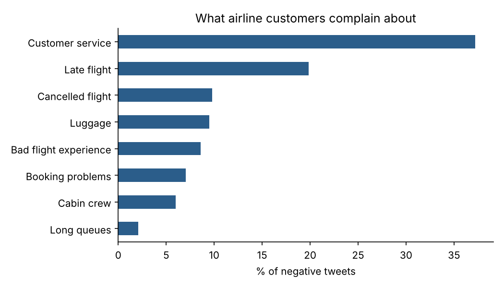
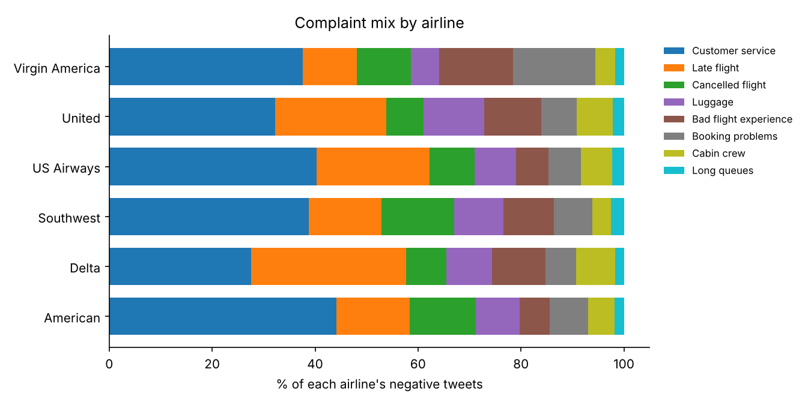

# Airline customer complaint classification

Classifying airline customer tweets by sentiment and complaint topic. The project compares a classic NLP baseline with sentence embeddings, a zero-shot transformer and zero-shot LLMs, then uses the best model to find out what airline customers complain about most.

**Data:** [Twitter US Airline Sentiment](https://huggingface.co/datasets/osanseviero/twitter-airline-sentiment): 14,640 tweets about six US airlines (Feb 2015), human-labelled for sentiment and, for negative tweets, the reason for the complaint. Licence: CC BY-NC-SA 4.0.

## Results

### Complaint topic (8 classes, 1,598 held-out negative tweets)

| Model | Uses training labels? | Macro F1 | Accuracy |
|---|---|---|---|
| Majority class | – | 0.067 | 0.364 |
| **TF-IDF (word + char n-grams) + logistic regression** | yes | **0.609** | **0.698** |
| Sentence embeddings (all-MiniLM-L6-v2) + logistic regression | yes | 0.554 | 0.633 |
| Zero-shot NLI (DeBERTa-v3-base-zeroshot-v2.0) | **no** | 0.550 | 0.645 |
| Zero-shot LLM (Qwen2.5-0.5B-Instruct), 400-tweet sample | no | 0.267 | 0.395 |
| Zero-shot LLM (Gemini 2.5 Flash) | no | *run `src/gemini_classify.py`* | |

On the same 400-tweet sample the LLM was scored on, TF-IDF reached 0.588 macro F1 and NLI 0.546 (`results/metrics_400_subset.json`).

### Sentiment (3 classes, 2,928 held-out tweets)

| Model | Macro F1 | Accuracy |
|---|---|---|
| Majority class | 0.257 | 0.627 |
| **TF-IDF + logistic regression** | **0.750** | **0.802** |
| Sentence embeddings + logistic regression | 0.732 | 0.768 |

### What I took from it

- **A well-tuned TF-IDF baseline still wins** on short, keyword-heavy text like tweets ("delayed", "bag", "on hold"). It's also fast, cheap and easy to explain, which matters if the output feeds an operational decision.
- **Zero-shot NLI gets about 90% of the way to the supervised model with no labelled data** (0.550 vs 0.609 macro F1). That makes it a strong option for a new complaint category or channel where nobody has labelled examples yet.
- **Model size matters for LLM zero-shot.** A 0.5B-parameter model running on a laptop CPU is not a reliable classifier here. The Gemini script is included to test a frontier model on the same prompt and topic descriptions.
- The weakest class is *Long queues* (F1 0.23, only 2% of complaints). With more data, that's where I'd focus first.

## Business insight

Using the TF-IDF topic model, I also classified the 1,190 negative tweets the original annotators marked "Can't tell", so the complaint mix covers all 9,178 negative tweets.



- **Customer service (37%) and late flights (20%) make up 57% of all complaints.** Problems with the flight itself, such as cabin, crew and comfort, are a much smaller share. Customers are mostly complaining about how disruption is handled.
- **Delta is the exception:** late flights are its top complaint (30%), and it has the lowest customer-service share (28%). Every other airline's top complaint is customer service, peaking at American (44%).
- The share of tweets that are negative ranges from 36% (Virgin America) to 78% (US Airways).



Full figures: `results/insights.json`.

## App

A small Streamlit app classifies any customer message by sentiment and, if it's negative, by complaint topic with confidence scores.

```bash
streamlit run app/streamlit_app.py
```

## Reproduce

```bash
pip install -r requirements.txt
cd src
python data.py                      # downloads the data, shows the class balance
python train_baselines.py           # TF-IDF and embedding models, about 2 min on CPU
python zero_shot.py --method nli    # about 20 min on CPU
python zero_shot.py --method llm --limit 400
python insights.py                  # complaint drivers and charts

# Optional: Gemini (free key from https://aistudio.google.com/apikey)
pip install google-genai
export GEMINI_API_KEY=...
python gemini_classify.py --limit 300
```

## Method notes

- **Cleaning:** removed links and `@mentions`, since airline handles would leak the airline into the features.
- **Topics:** the original 10 complaint reasons were merged to 8 (lost and damaged luggage combined), and "Can't tell" was excluded from training and evaluation.
- **Split:** stratified 80/20 train/test split with a fixed seed. Class weights are balanced so minority topics aren't ignored.
- **Metric:** macro F1 is the headline metric because the classes are imbalanced. Accuracy alone would reward predicting "Customer service" for everything.
- **Zero-shot labels:** zero-shot models get a plain-English description of each topic, not just its name. The local LLM scores each candidate topic by log-likelihood, so its answer is always a valid topic.

## Structure

```
src/data.py              download, cleaning, train/test splits
src/train_baselines.py   TF-IDF and embedding models, saves models/ and results/
src/zero_shot.py         zero-shot NLI and local LLM
src/gemini_classify.py   zero-shot with the Gemini API
src/insights.py          complaint analysis and charts
app/streamlit_app.py     interactive classifier
results/                 metrics, classification reports, predictions, figures
models/                  trained TF-IDF pipelines used by the app
```
